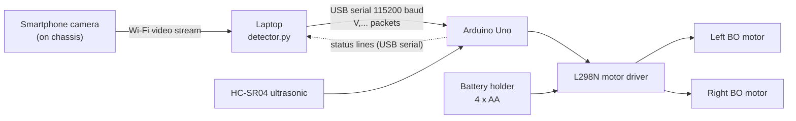
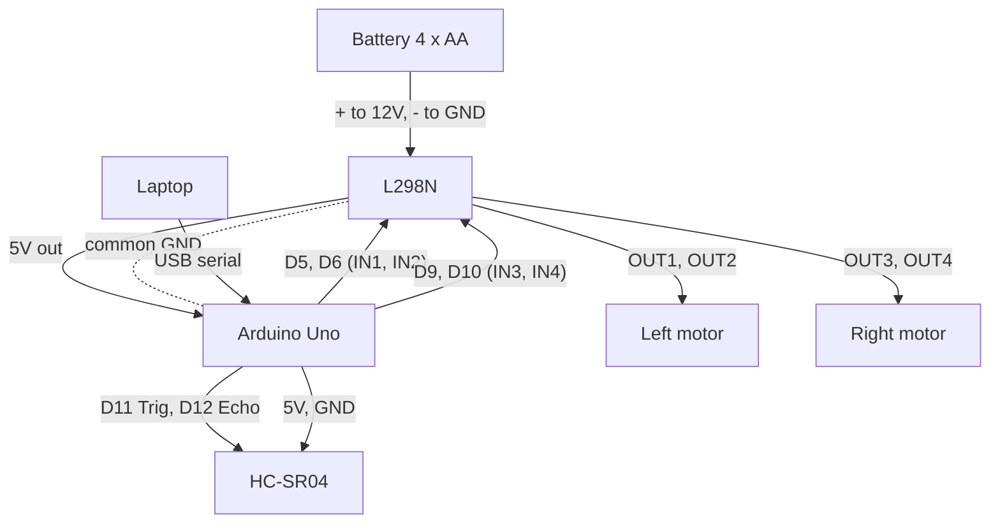
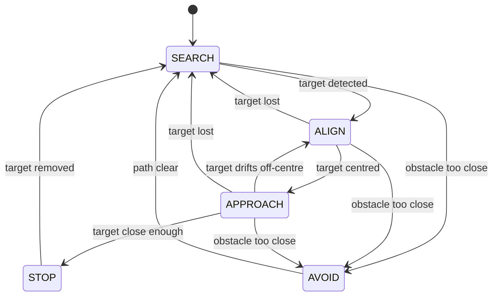

# Trinetra Robot

A vision-guided 2WD robot. A **smartphone on the chassis** streams video over Wi-Fi to a **laptop**, which runs Python object detection and sends commands over **USB serial** to an **Arduino Uno**. The Arduino drives the motors through an L298N and uses an HC-SR04 ultrasonic sensor as a local obstacle stop.

> The firmware (`firmware/trinetra_robot/trinetra_robot.ino`) and the Python simulator (`sim/robot_logic.py`) use the same constants. Change them in both places together.

---

## 1. Overview

- **Smartphone:** the camera. Streams video to the laptop (e.g. IP Webcam or DroidCam) over the same Wi-Fi or hotspot.
- **Laptop:** reads the stream, detects the target (`laptop/detector.py`) and sends one packet per frame to the Arduino.
- **Arduino Uno:** decides the motion (search, align, approach, stop, avoid) and drives the L298N.
- **HC-SR04:** local safety stop that the laptop cannot override.

## 2. Architecture



## 3. Hardware components and specs

| Component | Spec / purpose |
|---|---|
| 2WD Robot Chassis Kit | Frame, 2 BO motors, wheels, caster wheel |
| Arduino Uno (clone) | 5 V logic microcontroller. Reads sensor, receives laptop commands, drives the L298N |
| L298N Motor Driver | Dual H-bridge. Sets motor direction and power |
| HC-SR04 Ultrasonic Sensor | 2 cm to 400 cm, 5 V. Obstacle detection |
| Jumper wires (40 pcs) | Dupont male-to-female / female-to-female |
| Battery holder + 4 AA cells | About 6 V. Powers the motors via the L298N |
| Resistors (1k / 2k) | Not needed, Arduino uses 5 V logic |
| Smartphone | Mounted on the chassis as the camera |
| Laptop (Windows/Linux/macOS) | Python 3.9+, OpenCV, pyserial. Vision processing |
| USB cable (A to B) | Laptop to Arduino, 115200 baud serial |

## 4. Circuit connections

### 4.1 Power

| From | To | Note |
|---|---|---|
| Battery red (+) | L298N **12V** terminal | Motor power |
| Battery black (-) | L298N **GND** terminal | |
| L298N GND | Arduino GND | **Shared ground (mandatory)** |
| L298N **5V** terminal | Arduino 5V pin | Powers the Arduino (see 4.6) |

### 4.2 Motors

| Motor | L298N terminals |
|---|---|
| Left DC motor | OUT1, OUT2 |
| Right DC motor | OUT3, OUT4 |

### 4.3 Motor driver to Arduino

| L298N | Arduino pin |
|---|---|
| IN1 | D5 |
| IN2 | D6 |
| IN3 | D9 |
| IN4 | D10 |

### 4.4 HC-SR04

| HC-SR04 | Arduino |
|---|---|
| VCC | 5V |
| GND | GND |
| Trig | D11 |
| Echo | D12 |

### 4.5 Wiring diagram



### 4.6 Notes

- **Power:** the Arduino gets 5 V from both the L298N and USB, which is not ideal. If you see resets, power it from USB only (remove the L298N 5V wire, keep GND shared). With about 6 V from 4 AA cells, the L298N 5V output can sag.
- **Speed control:** only IN1 to IN4 are wired, so the ENA/ENB jumpers stay fitted. D5, D6, D9 and D10 support PWM, so speed is set by PWM on the IN pins.
- **Reversed motor:** swap its two wires on the L298N terminal.
- **Protection:** never power the motors from the Arduino 5V or 3.3V pins.

## 5. Robot behaviour (state machine)



Failsafe: if no valid packet arrives for about 500 ms, the Arduino stops the motors.

## 6. Serial protocol

Laptop to Arduino, one newline-terminated line per frame:

```
V,<detected>,<x_offset>,<size>
```

| Field | Range | Meaning |
|---|---|---|
| detected | 0 or 1 | Target visible |
| x_offset | -100 to 100 | Offset from frame centre (negative = left) |
| size | 0 to 100 | Target size, used as distance proxy |

Arduino to laptop: status lines such as `STATE=APPROACH` and `DIST=42`.

## 7. Simulation setup and tests

### 7.1 Wokwi (Arduino firmware simulation)

The real firmware runs in the Wokwi online simulator. Wokwi has no L298N, so four LEDs on D5, D6, D9 and D10 stand in for IN1 to IN4. Brightness shows the PWM speed.

1. Open [wokwi.com](https://wokwi.com), click **New Project**, choose **Arduino Uno**.
2. Open the `diagram.json` tab and replace its contents with `wokwi/diagram.json` from this repo.
3. Open `sketch.ino` and replace its contents with `firmware/trinetra_robot/trinetra_robot.ino`.
4. Press the green **Start** button. The Serial Monitor shows `TRINETRA READY`, then `STATE=FAILSAFE` until you send a packet.
5. Type a packet in the serial input box (for example `V,1,0,20`) and press Enter. Send one about every 300 ms, because the failsafe stops the motors after 500 ms without a packet.
6. Click the HC-SR04 and change its distance to test obstacles.

| LED | Arduino pin | Meaning |
|---|---|---|
| Green (left) | D5 (IN1) | Left motor forward |
| Red (left) | D6 (IN2) | Left motor backward |
| Green (right) | D9 (IN3) | Right motor forward |
| Red (right) | D10 (IN4) | Right motor backward |

Wokwi has no camera, so vision packets are typed manually. For continuous packets, use the Python simulator below.

### 7.2 Test scenarios

| # | Input (Serial Monitor) | Sensor | Expected |
|---|---|---|---|
| 1 | `V,0,0,0` | clear | SEARCH: rotates slowly |
| 2 | `V,1,-60,20` | clear | ALIGN: turns left |
| 3 | `V,1,60,20` | clear | ALIGN: turns right |
| 4 | `V,1,0,20` | clear | APPROACH: moves forward |
| 5 | `V,1,0,60` | clear | APPROACH: slows down |
| 6 | `V,1,0,90` | clear | STOP: target reached |
| 7 | `V,1,0,20` then `V,0,0,0` | clear | Back to SEARCH |
| 8 | `V,1,0,20` | obstacle at 15 cm | AVOID: stops, turns away |
| 9 | `V,1,0,20` | obstacle at 100 cm | Normal APPROACH |
| 10 | `V,0,0,0` | obstacle at 15 cm | AVOID overrides SEARCH |
| 11 | no input for 1 s | clear | Failsafe: motors stop |
| 12 | `garbage` | clear | Ignored, no crash |
| 13 | `V,1,0,20`, then obstacle removed | clear | Resumes APPROACH |

### 7.3 Python simulator (no hardware needed)

The simulator runs the same decision logic as the Arduino in a 2D arena with a differential-drive robot, a camera model (60° field of view, noise, dropouts) and an HC-SR04 model (noise). Its constants are in `sim/robot_logic.py` and must match your `.ino`.

```bash
pip install -r requirements.txt

python sim/run_sim.py --scenarios              # the 13 test scenarios above, PASS/FAIL
python sim/run_sim.py --seed 3 --plot run.png  # one run: state trace and path image
python sim/trial_runner.py                     # 50 randomised trials, success rate, sim/results.csv
```

Sample result (50 trials, 2 obstacles): 44/50 successful (88%), mean 11 s to reach the target. Failures were 4 obstacle collisions and 2 timeouts.

### 7.4 Running the real detector (laptop)

`laptop/detector.py` reads the phone stream, detects a coloured target and sends packets to the Arduino.

```bash
python laptop/detector.py --stream http://<phone-ip>:8080/video --port COM3          # Windows
python laptop/detector.py --stream http://<phone-ip>:8080/video --port /dev/ttyUSB0  # Linux (macOS: /dev/cu.usbmodem*)
python laptop/detector.py --stream 0 --no-serial --show                              # webcam test, no Arduino
```

Use `--color red|orange|yellow|green|blue` to pick the target colour. Tune the HSV ranges in `detector.py` for your lighting.

### 7.5 Choosing how the robot recognises the object

The Arduino is never trained. All recognition happens on the laptop in `laptop/detector.py`, which always outputs the same `V,...` packet.

| Method | Command | Training needed |
|---|---|---|
| Colour (default) | `python laptop/detector.py --stream 0 --no-serial --show --color blue` | No |
| Click to calibrate | `python laptop/detector.py --stream 0 --no-serial --show --calibrate` (click the object) | No |
| Pretrained YOLO | `python laptop/detector.py --stream 0 --no-serial --show --model yolov8n.pt --classes bottle` | No (80 common objects) |
| Your own YOLO model | `python laptop/train_yolo.py --data data.yaml`, then `--model runs/detect/train/weights/best.pt` | Yes: 100 to 300 labelled photos |

YOLO needs `pip install ultralytics` and runs slower on a laptop CPU, so keep the robot speed low. The packet `size` is the object's width as a percentage of the frame, so re-tune `STOP_SIZE` and `SLOW_SIZE` for your object.

### 7.6 Connect and run on the real robot

1. Wire the robot as in Section 4. Put the motor battery on the L298N.
2. Install the Arduino IDE. Open `firmware/trinetra_robot/trinetra_robot.ino`, choose **Tools > Board > Arduino Uno** and the right **Port**, then click **Upload**. (Clone boards with a CH340 chip need the CH340 driver.)
3. Open **Serial Monitor** at **115200 baud**, set line ending to **Newline**. You should see `TRINETRA READY`. Type `V,1,0,20` quickly and repeatedly: the wheels should turn forward. Test with the wheels lifted off the floor first.
4. **Close the Serial Monitor.** Only one program can use the USB port.
5. Start the phone camera app (IP Webcam or DroidCam) on the same Wi-Fi as the laptop.
6. On the laptop: `pip install -r requirements.txt`, then

```bash
python laptop/detector.py --stream http://<phone-ip>:8080/video --port COM3 --show --calibrate
```

Click the target in the preview window to set its colour. The robot now searches, aligns, approaches and stops. Press `q` to quit. If the laptop stops sending, the Arduino halts the motors after 500 ms.

If a wheel spins the wrong way, swap that motor's two wires on the L298N. If the motors do not turn at low speed, raise `MIN_PWM` in the firmware.

## 8. Physical implementation

- **Chassis:** Arduino, L298N and battery holder on top. HC-SR04 at the front, facing forward.
- **Smartphone:** mounted facing forward, streaming over Wi-Fi to the laptop.
- **Laptop:** stays off the robot. A **long USB cable** tethers the Arduino to it. Keep the cable slack and clear of the wheels.
- **Roles:**
  - Smartphone: live video.
  - Laptop: vision, logging, display.
  - Arduino: motion decisions and safety.
  - L298N: switches battery power to the motors.
  - HC-SR04: collision protection.
- **Build steps:**
  1. Assemble the chassis, motors and wheels.
  2. Wire the battery to the L298N and the motors to OUT1 to OUT4. Test with a simple motor sketch.
  3. Wire IN1 to IN4 to D5, D6, D9 and D10.
  4. Add the HC-SR04 on D11 and D12 and check readings.
  5. Flash the firmware.
  6. Mount the phone, start the stream, connect USB and run `detector.py`.

## 9. Simulation limitations and hardware plan

| Limitation | Effect | Mitigation |
|---|---|---|
| No camera or phone stream in Wokwi | Vision untested | Typed packets, Python simulator |
| Ideal motors | No slip, drift or inertia | Tune on hardware |
| Perfect ultrasonic | No noise or false echoes | Add filtering, test on hardware |
| No lighting variation | Detector robustness unknown | Test in varied lighting |
| No Wi-Fi or USB latency | Stream lag delays reactions | Measure end-to-end delay, keep speeds low |
| No cable tether | USB cable pulls the robot | Long, slack cable, small arena |

**Hardware plan:**

1. Bench-test motors and L298N.
2. HC-SR04 reading and obstacle stop.
3. Laptop-to-Arduino serial link with typed packets.
4. Phone stream into the laptop, detection with print only.
5. Close the loop (detector drives the robot).
6. Tuning, failsafe testing and the 50-trial run.

## 10. Repository layout

```
firmware/trinetra_robot/trinetra_robot.ino   Arduino firmware
firmware/test/host_test.cpp                  firmware logic test (run on a PC)
wokwi/diagram.json                           Wokwi circuit for the simulation
laptop/detector.py        phone stream -> detection -> serial packets
laptop/train_yolo.py      optional: train YOLO on your own object photos
sim/robot_logic.py        Python copy of the Arduino decision logic
sim/sim_core.py           2D world, camera and ultrasonic models
sim/run_sim.py            test scenarios and single run
sim/trial_runner.py       50-trial runner
requirements.txt
README.md
```
